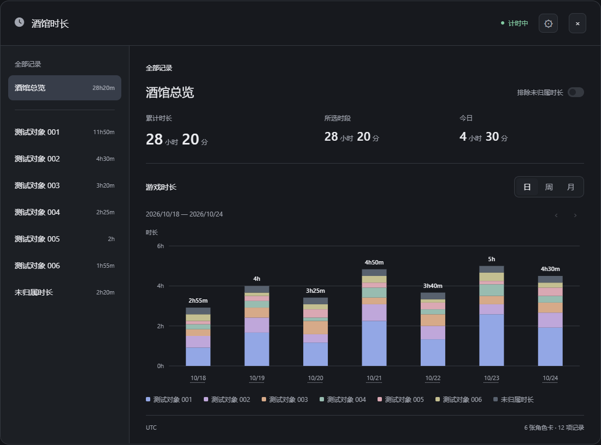
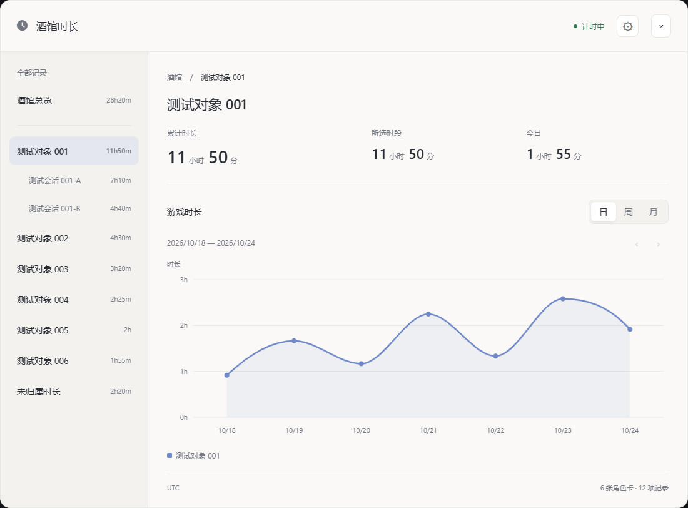
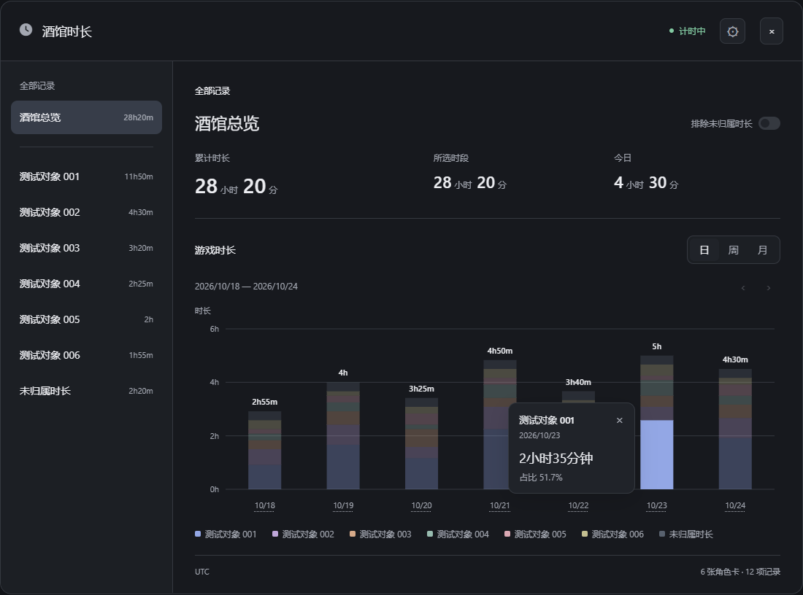

# 酒馆时长

SillyTavern 的角色与聊天时长统计扩展，包含前端扩展和服务端插件。当前版本 **0.1.14**。

- 在独立界面查看酒馆总时长、角色卡时长和每份聊天的时长。
- 日／周／月统计；总览为堆叠柱状图，角色与聊天为平滑曲线。
- 点击柱块、日期或曲线数据点查看时长与占比；再次点击收起。
- 明暗模式、触摸操作、长名称省略、可滚动明细。
- 导出、合并导入、清除确认与清除前备份。
- 同一账号的窗口按登记顺序排队，只累计一份总时长。
- 后端版本提醒可关闭，齿轮中可查看版本、更新命令和更新说明。

统计文件包含角色名、聊天名和使用时间，分享导出文件前请确认其中的信息适合公开。

## 面板预览

截图中的编号名称和时长均为独立构造的合成数据。点击图片可查看大图。

| 酒馆总览 | 角色统计 | 总览点击数据标签 |
| --- | --- | --- |
| [](docs/images/overview.png) | [](docs/images/role.png) | [](docs/images/overview-selection.png) |

## 安装

需要 SillyTavern **1.14.0 或更新版本**、Git，以及满足酒馆自身要求的 Node.js。插件本身支持 Node18+；例如 ST1.19.0 要求 Node20+。前后端均需安装。

### 1. 安装后端

停止酒馆，在 **SillyTavern 根目录**执行：

```sh
node plugins.js install https://github.com/linha0l/sillytavern-playtime.git
```

在酒馆的 `config.yaml` 中启用服务端插件，然后重新启动酒馆：

```yaml
enableServerPlugins: true
```

安装目录通常为 `plugins/sillytavern-playtime/`，服务端插件标识为 `tavern-playtime`。

### 2. 安装前端

打开酒馆顶部的 **扩展程序 → 安装扩展程序**，粘贴：

```text
https://github.com/linha0l/sillytavern-playtime
```

安装完成后刷新页面，从扩展设置中的 **酒馆时长** 长条入口打开。酒馆原生扩展安装方式见[官方文档](https://docs.sillytavern.app/extensions/)。

### Android／Termux

已有酒馆时，直接进入自己的酒馆根目录执行相同的后端安装命令，再启用 `enableServerPlugins`，通过原来的方式重启酒馆。在手机浏览器中安装前端。

下面只示范默认安装路径，路径不同请自行替换：

```sh
cd ~/SillyTavern
node plugins.js install https://github.com/linha0l/sillytavern-playtime.git
```

尚未安装酒馆或缺少 Git／Node 时，先按照[酒馆官方 Termux 安装说明](https://docs.sillytavern.app/installation/android-%28termux%29/)准备环境。

## 计时规则

- 同一酒馆账号的窗口共用队列，不同设备、浏览器或访问地址也按后端登记顺序排队；其他窗口显示等待。
- 队首窗口打开角色聊天时，同时累计聊天、角色和酒馆时长；主界面、临时聊天、群聊归入“未归属时长”。侧栏的“未归属时长”只展开临时聊天。
- 正常关闭后交接；突然关闭或后台冻结导致心跳停止时，约3分钟后交接。可能包含这段宽限误差。
- 队首连续失焦30分钟后暂停，保留队位；恢复焦点后继续，不补算暂停时间。刷新会重新排队。
- 计时归属跟随实际打开的聊天，统计面板仅切换查看范围。
- 时间和日期分桶使用后端时间／时区，持续计时使用单调时钟；改变后端时区会重新划分日、周、月，累计时长不变。

本插件存在分钟级保存、后台冻结等带来的少量误差。

## 数据

每个酒馆账号独立保存到 `<用户目录>/.tavern-playtime/tracking.json`，通常为 `data/<账号>/.tavern-playtime/tracking.json`。每分钟保存，切换聊天、导出等操作也会保存。服务停止期间不补算。

导入会合并数据，相同记录ID不重复累计。“导入数据”旁的问号可查看说明；需要仅保留导入数据时，请先清除当前数据。清除前默认导出，成功保存备份后才清空；备份在 `.tavern-playtime/backups/`。清除会重置统计起始日期，已有备份保留。

## 更新

### 前端

打开 **扩展程序 → 管理扩展程序**，等待更新检查完成。有更新时，“酒馆时长”的名称会高亮，右侧显示更新按钮。点击该按钮，完成后刷新酒馆页面。

### 后端

在 **SillyTavern 根目录**执行：

```sh
git -C plugins/sillytavern-playtime pull --ff-only
```

然后通过平时的方式停止并重新启动酒馆，再刷新页面。仅更新文件或刷新浏览器，仍会运行旧后端。

Termux 中同样操作，例如默认安装路径：

```sh
cd ~/SillyTavern
git -C plugins/sillytavern-playtime pull --ff-only
```

前端和后端是两个安装目录，需要分别更新。更新程序后，已有时长数据会保留。

### 后端更新提醒

面板会比较当前前端的配套要求与后端实际运行版本；需要更新时，齿轮显示圆点，点击 **版本与更新** 查看版本和后端更新命令。旧后端未提供版本信息时显示“后端版本待确认”；更新后端并重启酒馆后，满足配套要求即消除提醒。

**后端更新提醒**默认开启，可在齿轮菜单关闭，风险说明见旁边的问号；设置保存在当前浏览器，关闭后仍可手动查看“版本与更新”。

卸载时移出前后端程序目录，统计数据可保留。

## 兼容性与开发

已验证 ST1.14.0～1.19.0、Windows Chrome／Firefox、实体Android Chrome与Termux Node。详细版本和测试边界见[兼容性记录](docs/compatibility.md)。Safari／iOS及普通Termux终端长期保活尚未验证。

运行测试：

```sh
npm test
```

根 `manifest.json` 供酒馆前端安装使用；根 `package.json` 的 `main` 指向服务端入口。`frontend/` 与 `server/` 为实际运行代码，`tests/` 为合成数据测试。[发行校验](release/verification.md)及[更新记录](CHANGELOG.md)随仓库保存。

## 许可证

[MIT](LICENSE)
